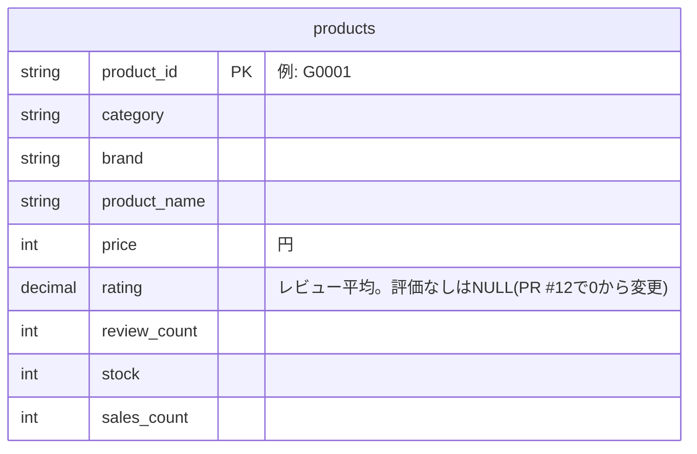

# Tech0 Step3-1 Giftia ケース　要件定義書

Giftia「送別ギフトを、仲間と納得して決められる」施策 ― 何を、なぜこの構成・このロジックで作るか

| チーム名 | 東京Drinking Party |
|---|---|
| メンバー | タケ（班長）、むっちゃん、まいまい |
| 初版作成日 | 2026年11月7日 |
| 最終更新日 | 2026年11月9日 |
| 対応する要求定義書 | クラス5_東京Drinking Party_要求定義書 |
| 班のリポジトリ | AR7ST/giftia（画面 giftia-frontend/ と API backend/ を1つにまとめたモノレポ。PR #6）、giftia-hub |

生成AI利用：あり

## 更新履歴

| 日付 | 更新した章 | 更新内容 | 更新者 |
|---|---|---|---|
| 2026/11/5 | 全体 | 生成AIで素案を作成 | タケ |
| 2026/11/7 | 3・4.1・5 | 打合せで決めた方針に沿い、素案から3週目の範囲を抜き出してテンプレートに記入（初版） | まいまい |
| 2026/11/7 | 全体 | 初版を確認・修正（FR-01に並び順のルールを追加、検証項目VR-01を機能と分離）。5章のER図を作成。リポジトリをモノレポ（giftia）に合わせて更新 | タケ |
| 2026/11/9 | 5.2 | 要件定義をもとに Giftia を更新（発展2）。FR-02・5.2「評価なしを0点にしない」にそろえ、評価がない商品を「評価0」ではなく「評価 不明」と表示するようにした（PR #12）。5.2 に注記を追加 | タケ |

※3週目の範囲（3章・4.1・5章）を記載。1・2・4.2・4.3・6〜10章と付録は4週目以降に記入します。

## 3. 要求→要件マッピング

| 要求ID | 要求 | 要件ID | 要件（何を作るか） | 確認方法 |
|---|---|---|---|---|
| BR-01 | 共同予算に合う、在庫のある候補を把握できること | FR-01 | 人数×1人あたり予算を上限に、在庫ありの商品をDBから複数件取得し、販売数→評価→商品IDの順（暫定）で表示する | 予算外・在庫切れが出ず、並び順がルールどおりか確認 |
| BR-02 | 候補の特徴・不明な点を確認し、選んだ理由を整理できること | FR-02 | 候補ごとに商品名・価格・説明・評価を表示し、ない情報は「不明」と示す | 表示と元データを照合する |
| BR-03 | 選んだ理由を同僚に説明し、相談しながら決められること | FR-03 | 選んだ1〜3件と理由から相談文を作り、コピーできる（送信は利用者） | 相談文が表示され、コピーできるか確認 |
| BR-04 | 送別シーンの購入率を1.7％から2.2％へ改善すること（仮目標） | VR-01（検証） | 試用で、説明しやすさ・相談しやすさを評価する（機能ではない） | 購入率は将来の実測で確認 |
| BR-02 | 候補の特徴・不明な点を確認し、選んだ理由を整理できること | DR-01 | 既存の列で足りるか確認する。Phase1では列を追加しない | 配布のデータ定義と班のDBを照合 |

## 4. 機能要件

### 4.1 機能一覧

| ID | 機能名 | 概要 | 対応する要求ID | 優先度 |
|---|---|---|---|---|
| FR-01 | 条件検索・候補表示 | 人数×1人あたり予算を上限に検索し、販売数→評価→商品IDの順で表示（暫定） | BR-01 | 高 |
| FR-02 | 比較材料表示 | 商品名・価格・説明・評価を表示し、ない情報は「不明」と示す | BR-02 | 高 |
| FR-03 | 相談用テキスト表示 | 選んだ最大3候補と理由から相談文を作り、コピーする | BR-03 | 高 |

## 5. データ設計

### 5.1 ER図（配布の基本ER図からの拡張）

> ※元のGoogleドキュメントには画像として埋め込まれたER図がありますが、ここでは現在の実装コード（`backend/main.py`・`backend/database.py`・`giftia-frontend/lib/api.ts`）から実際に確認できる範囲だけをMermaid記法で再構成しています。配布された「データ定義.md」（Tech0の配布資料）はTech0のConfidential資料でありAGENTS.mdのルールによりリポジトリに複写しないため、`products`以外のテーブル（会員・注文等）が配布資料に存在する場合でも、ここには含めていません。

現在コードから確認できるのは `products` テーブル1つのみ（`backend/main.py`の`/api/search`・`/api/health`が参照する列）。会員・贈り先などの関連テーブルは、要求定義書5.3「選ばなかった案」で言及されているのみで、本リポジトリのコードからは未確認です。

### 5.2 追加するデータの定義

Phase1では追加しない。既存の列を使い、評価や説明がない商品は「不明」と表示する（評価なしを0点にしない）。商品特徴・参考情報は、既存の列で足りないと分かった場合のみ追加を検討する。

※現在の検索API（backend/main.py）は、在庫ありの商品を販売数の多い順で返している。FR-01の予算の上限と、評価による並び替えはこれに足す形で作る。

2026/11/9 更新：評価がない商品は、API（backend/main.py）が評価を null（なし）で返し、画面のカード（ResultCard.tsx）は「評価 不明（0件）」と表示するようにした（FR-02、PR #12）。評価がある商品の表示と並び順は変えていない。

### 5.3 データをどこに持たせたか

| 項目 | 内容 |
|---|---|
| 選んだ持たせ方 | 既存の products の列を使う（Phase1は追加なし） |
| 選ばなかった案 | 会員・贈り先側に持たせる案／全8,000件に一括で付ける案 |
| 理由 | まず既存の情報で価値を確かめる。足りなければ対象商品を絞って追加する（商品部の工数に限りがあるため） |

### 5.4 データ供給計画

Phase1は既存データのみのため、追加の供給作業はなし。追加する場合は対象商品を絞り、商品部の月5人日程度の範囲で行う（Exhibit 5）。

---

*1・2・4.2・4.3・6〜10章と付録は原本（下記リンク）でも未記入（4週目以降に記入予定）のため、本ファイルにも含まれていません。*

*出典: クラス5_東京Drinking Party_要件定義書（提出用）(Google ドキュメント, 2026-11-09更新) をMarkdown化したもの。原本: https://docs.google.com/document/d/17cbMGdWMRYxOWZusGtCB7o-_m6KvIX5pXz1pSerIDG4/edit*
